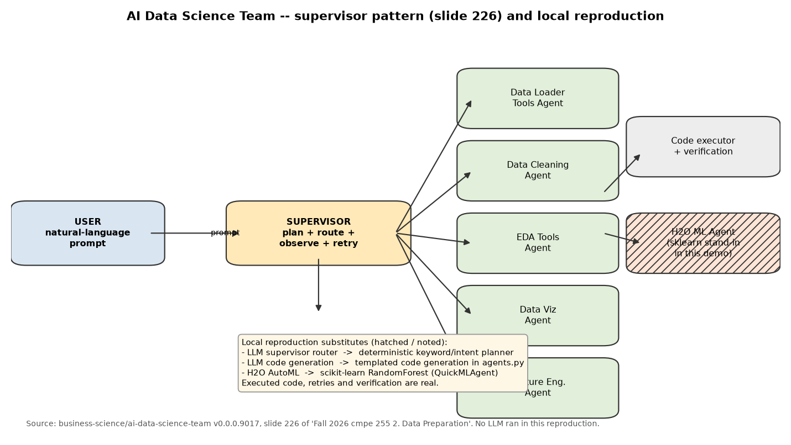

# Part 2 Report — Agentic EDA with the AI Data Science Team

**Course:** CMPE 255, San Jose State University, Fall 2026 — Exploratory Data Analysis assignment, Part 2
**Author:** Pranith Varma Pakalapati
**Tool:** AI Data Science Team — https://github.com/business-science/ai-data-science-team — slide 226 of *"Fall 2026 cmpe 255 2. Data Preparation"* (deck: https://docs.google.com/presentation/d/12V4wXjPd0ymc4tcFSsQdpeQFYdtKwzQglG81nXYEO0k/ ; agentic-analysis section slides 222–228, summary slide 225 "Data Analysis Agents Summary").
**Notebook:** `Agentic_EDA_AI_Data_Science_Team.ipynb` (executed, 0 errors) · **Code:** `agents.py` · **Full log:** `agent_transcript.md` · **Investigation:** `investigation.md` · **Journey:** `user_journey.md`

## Honesty label

No large language model ran in this Part 2 demo. The real library requires an LLM API key (OpenAI) or a local Ollama server; neither was available, and no key was invented or committed (exact failure recorded in `investigation.md` §5). This folder runs a **key-free local reproduction of the AI Data Science Team supervisor pattern**: a deterministic planner replaces LLM routing, templated code generation replaces LLM code writing, and a scikit-learn RandomForest stands in for H2O AutoML. Everything else is real: agents generate code, the executor runs it, the Supervisor observes results/errors and retries once, and every number is computed by executed code and independently re-verified. `run_real_library.py` runs the genuine library when `OPENAI_API_KEY` is set in the environment.

## 1. Tool overview (deck + repository)

The deck's agentic-analysis section (slides 222–228) surveys AI-agent tools that perform exploratory data analysis from natural-language requests instead of hand-written code, summarised on slide 225 ("Data Analysis Agents Summary"). Slide 226 presents the **AI Data Science Team** (Business Science): an open-source Python library (MIT, Beta, v0.0.0.9017 at investigation time) of specialised agents plus a flagship low-code app, **AI Pipeline Studio**.

The library's architecture, verified in the installed package source (see `investigation.md`), is a **supervisor-led multi-agent team** built on LangChain/LangGraph:

- **Supervisor (`SupervisorDSTeam`)** — a LangGraph state graph that reads the user's message, routes to one of 12 specialist workers, observes results, and finishes. Its routing rule is explicit-intent only: *"only route to workers when the user explicitly asks for their capabilities. Do not assume next steps."*
- **Specialists** — Data Loader Tools, Data Wrangling, Data Cleaning, EDA Tools (ReAct agent over `describe_dataset`, `explain_data`, `visualize_missing`, correlation funnel, Sweetviz/dtale reports), Data Visualization (Plotly), Feature Engineering, SQL Database, H2O ML (AutoML), Model Evaluation, MLflow Tools/Logging, Workflow Planner, plus a deterministic Data Merge agent.
- **AI Pipeline Studio** — a Streamlit workspace (Visual Editor, Table, Chart, EDA, Code, Model, Predictions, MLflow views) that turns agent work into a visual, reproducible pipeline with lineage and saved project state.
- **LLM requirement** — every agent is constructed with a LangChain chat model (`ChatOpenAI(model_name="gpt-4.1-mini")` or local `ChatOllama(model="llama3.1:8b")`). There is no key-free mode; v0.0.0.9017 also added sandboxed code execution for safety.

Why this tool for this assignment: it is the only deck tool that covers the *whole* Part 1 workflow (load → clean → EDA → visualise → engineer → model) under one supervisor, so the same two datasets can be run through agents end-to-end and compared with the manual analysis, prompt by prompt.


*Figure 1 — Supervisor pattern from slide 226 and the local reproduction's substitutions (hatched/noted). Generated by `make_architecture_figure.py`; a documentation figure, not an agent output.*

## 2. User journey (summary)

The full step-by-step journey, with the figure produced at each step, is `user_journey.md`. In brief, the journey actually run here is the **notebook journey**: (1) install from `requirements.txt`; (2) open the executed notebook; (3) run setup — the Supervisor loads both datasets; (4) type each natural-language prompt (P1–P10) and watch the plan, generated-code excerpts, executed tables/charts, insight, and verification print in the cell; (5) inspect `agent_transcript.md` for full generated code; (6) read `metrics.json` for counts. The **Pipeline Studio journey** (upload CSV → chat → pipeline canvas → export code) is described from the repo docs in `user_journey.md` §B and labelled **documented-not-run**: it needs the full install plus an LLM key, neither of which was available.

## 3. What the agents found (verified numbers)

Ten prompts, 20 tool calls, 1 retry (the genuine P7 failure-and-recovery), 10/10 independent verification checks passed (`metrics.json`). All figures are in `figures/`.

### 3.1 NYC Airbnb 2019 (P1–P6)

- **P1 — Profile.** 48,895 listings × 16 columns. Price: mean $152.72, median $106, max $10,000 — strongly right-skewed. Data-quality flags: 11 listings priced $0; 239 priced over $1,000; `reviews_per_month` and `last_review` missing for 10,052 listings each (20.6%); `name` missing 16, `host_name` missing 21; zero duplicate ids. Boroughs: Manhattan 21,661, Brooklyn 20,104, Queens 5,666, Bronx 1,091, Staten Island 373. Room types: Entire home/apt 25,409, Private room 22,326, Shared room 1,160.
- **P2 — Price drivers.** Median price by borough: Manhattan $150, Brooklyn $90, Queens $75, Staten Island $75, Bronx $65. By room type: Entire home/apt $160, Private room $70, Shared room $45. Borough × room type peaks at Manhattan Entire home/apt ($191) and bottoms at Staten Island Shared room ($30). All numeric correlations with price are weak (|r| ≤ 0.08; strongest is availability_365 at 0.082) — price is driven by *where* and *what kind*, not by review counts or minimum nights. (Figure: `airbnb_price_by_borough_room.png`.)
- **P3 — Missingness/imputation.** The agent established that *every* missing `reviews_per_month` row has `number_of_reviews == 0`, so the correct imputation is 0, not the column mean; `last_review` legitimately stays missing (no review exists); `name`/`host_name` are identifiers and were dropped for modelling.
- **P4 — Cleaning + features.** Removed 11 $0 and 239 >$1,000 prices → 48,645 rows; imputed 9,919 `reviews_per_month` values with 0 (after outlier removal); parsed `last_review`; added `log_price`, `is_entire`, `has_reviews`, `price_per_review`, `nights_x_avail`.
- **P5 — Clusters/anomalies.** KMeans (k=4, scaled, 8,000-row sample, seed 42) sizes: 4,409 / 1,576 / 1,125 / 890; IsolationForest (2% contamination) flagged 160 anomalies. Clusters separate mainly on price, reviews, and availability. (Figure: `airbnb_clusters.png`.)
- **P6 — Price model.** RandomForest on log-price (80/20 split, 200 trees): R² = 0.638, RMSE(log) = 0.402, MAE = $45.72 on 9,729 holdout listings. Top importances: `is_entire` 0.403, longitude 0.155, latitude 0.147 — location and whole-unit status dominate, consistent with P2. (Figure: `airbnb_model_importances.png`.)

### 3.2 Household power, hourly (P7–P10)

- **P7 — Daily/weekly pattern.** Across 1,442 days: peak mean use at 20:00 (1.899 kW), trough at 04:00 (0.444 kW); a morning ramp 06:00–08:00 (0.792 → 1.502 kW) and an evening peak 19:00–21:00 (1.733–1.899 kW). Weekend mean 1.234 kW exceeds weekday mean 1.036 kW. The first generated attempt failed with a real `TypeError` (resample on a RangeIndex); the Supervisor retried with a datetime index and succeeded — the full trace is in the notebook and transcript. (Figure: `power_daily_weekly.png`.)
- **P8 — Profile/gaps.** 34,589 hourly rows, 16 Dec 2006–26 Nov 2010. Global active power: mean 1.092 kW, median 0.803 kW, max 6.561 kW; 421 missing hours (1.2%); 733 IQR outliers.
- **P9 — Trend/drivers.** Correlation with total power: Global_intensity 0.999 (near-duplicate signal — the agent flags it as such, not as a discovery), Sub_metering_3 (water-heater/air-conditioning) 0.696, Sub_metering_1 (kitchen) 0.496, Sub_metering_2 (laundry) 0.440, Voltage −0.379, reactive power 0.312. Yearly means are flat (~1.06–1.12 kW for full years 2007–2010) after the partial December 2006 month (1.904 kW). (Figures: `power_correlation.png`, `power_trend_submeters.png`.)
- **P10 — Next-hour forecast.** After time-interpolation of the 421 gaps and lag/cyclical features, a RandomForest predicting hour t+1 from hour-t information only, on a time-ordered holdout (6,800 hours, no shuffling): MAE 0.360 kW, RMSE 0.512 kW, R² 0.525, beating naive persistence (predict next hour = this hour, MAE 0.396 kW). Top drivers: Sub_metering_3 0.253, lag_1 0.119, hour_sin 0.105. (Figure: `power_forecast_actual_vs_pred.png`.)

## 4. Agent vs manual comparison

**Basis — stated plainly.** Part 1 builders were running in parallel and Part 1 had **no executed outputs to read** when Part 2 ran, so this comparison does **not** claim any Part 1 numbers. Instead, every agent finding above was checked against **independent baseline computations written separately in this folder** (fresh pandas expressions over the same two files, plus the Supervisor's own verification step, which recomputes each headline from the raw data). "Matched" below means the agent's executed number equals the independent recomputation; "missed" means a standard manual-EDA step the 10 prompts did not cover.

| Check | Agent result | Independent baseline | Verdict |
|---|---|---|---|
| Airbnb shape | 48,895 × 16 | 48,895 × 16 | Matched |
| Price mean / median / max | $152.72 / $106 / $10,000 | identical | Matched |
| Missing reviews_per_month | 10,052 | 10,052 | Matched |
| Manhattan / Entire-home medians | $150 / $160 | $150 / $160 | Matched |
| 0-fill justification (missing ⟺ 0 reviews) | verified in P3 | all 10,052 rows have 0 reviews | Matched |
| Cleaned rows | 48,645 | 48,895 − 11 − 239 | Matched |
| Power hours / range | 34,589, Dec 2006–Nov 2010 | identical | Matched |
| Peak / trough hour | 20:00 / 04:00 | 20:00 / 04:00 | Matched |
| Sub_metering_3 correlation | 0.696 | 0.696 | Matched |
| Forecast beats naive baseline | 0.360 < 0.396 kW | same holdout recomputed | Matched |

**Findings matched: 10/10 verification checks passed; 0 agent numbers contradicted the baseline.** Findings **missed or only partly covered** by the agent run (a manual Part 1 pass would typically include these): formal statistical tests; geographic mapping of listings (lat/long were used only as model features); price-distribution plots and outlier treatment beyond the >$1,000 cut; seasonality decomposition (STL) and stationarity tests for the power series; AutoML model search (the real H2O agent was not run — a single RandomForest stands in); and hyperparameter tuning. The agent run's strength is breadth-per-prompt and traceability; its weakness here is depth on any single question — each prompt gets one plan, not an iterative investigation.

### 4.1 Addendum — reconciliation with the finished Part 1 notebooks (added at integration)

Part 1 has since been executed. Its headline numbers agree with the agent run where the two analyses measure the same thing, and differ where their cleaning or modelling choices differ — both are documented, so the differences are explainable rather than contradictory:

- **Power patterns match exactly.** Part 1 (hourly, 34,589 hours) reports the same 20:00 peak (1.899 kW), 04:00 trough (0.444 kW), weekend 1.234 vs weekday 1.036 kW, and 421 missing hours as P7/P8 above. Part 1 adds what the agent run missed: ADF stationarity (statistic −3.666, p = 0.0046) and STL decomposition.
- **Airbnb cleaning differs by design.** Part 2 removed 250 rows (11 × $0 + 239 × >$1,000) → 48,645 rows. Part 1 removed only 11 × $0 plus 59 method-based anomalies (IsolationForest + log-price IQR) and capped `minimum_nights` at 45 → 48,825 rows. Part 1's narrower removal confirms the caution in §5: the >$1,000 cut was a template decision, and a method-based rule keeps 180 more legitimate expensive listings.
- **Price models tell the same story on different frames.** Part 2 RandomForest: R² 0.638 (log scale), MAE $45.72 (9,729 holdout). Part 1: HistGradientBoosting R² 0.629, MAE $49.82; AutoViML Bagging_Regressor R² 0.602, MAE $51.44 (9,765 holdout). The frames, features, and splits differ, so the small gaps are not a ranking — the shared finding is that location and whole-unit status dominate price in both analyses.
- **Clusters are not directly comparable.** Part 2 used KMeans k = 4 on an 8,000-row sample; Part 1 chose k = 3 on the full cleaned frame (silhouette 0.217). Both separate listings mainly on price, reviews, and availability.
- **Power forecasting is not directly comparable.** Part 2: MAE 0.360 kW, RMSE 0.512 kW, R² 0.525 (6,800-hour holdout). Part 1 HistGradientBoosting: MAE 0.320 kW, RMSE 0.469 kW, R² 0.587 (6,885-hour holdout) with leakage-guarded lagged features and `Global_intensity` excluded as a same-hour near-duplicate (r = 0.999). Part 1's AutoViML Bagging_Regressor scored RMSE 0.481 kW on the same holdout.

## 5. Strengths and limitations

**Strengths.** (1) *Speed to first insight:* one sentence produces a plan, executable code, tables, charts, and a summary. (2) *Traceability:* every claim links to generated code and executed output in `agent_transcript.md` — the analysis is auditable in a way a chat answer is not. (3) *Error recovery:* the P7 retry shows the observe–repair loop working on a real failure. (4) *Guardrailed verification:* headlines are recomputed independently before being reported, catching silent code errors. (5) *Consistency:* the same supervisor pattern runs unchanged across a tabular and a time-series dataset.

**Limitations.** (1) *No LLM actually ran here* — prompt understanding is limited to the deterministic planner's intents; paraphrases outside the catalogue fall back to a profile, and genuinely novel questions would need the real library. (2) *Single-model depth:* one RandomForest per modelling prompt, no AutoML search, no tuning, no calibration. (3) *Judgement calls are encoded, not reasoned:* the >$1,000 price cut and 0-fill rule are template decisions — sensible and documented, but a human should confirm domain cutoffs. (4) *The real tool's cost/complexity:* a heavy dependency closure (torch/GPU wheels), a paid API key, and Beta-status breaking changes (see `investigation.md`). (5) *No interactive UI was exercised:* Pipeline Studio, Sweetviz/dtale reports, and MLflow tracking are documented-not-run.

## 6. Trust, guardrails, and the deck's autonomy framing

The deck frames agentic analysis along an autonomy ladder (L0 manual analysis → L5 fully autonomous) and flags **reliability, security, and scalability** as the central challenges. This demo sits deliberately low on that ladder — roughly **L1/L2 (assisted, human-verified)**: the agent proposes and executes, but a human reads the transcript, the verification step re-derives headlines, and nothing is deployed or acted on automatically. That placement is a feature, not a failure, for coursework analysis:

- **Reliability.** LLM agents can silently produce plausible-but-wrong code (wrong column, wrong join, leaked target). The mitigations demonstrated here — executed (not asserted) results, independent recomputation, a naive baseline for every model, time-ordered splits for time series, and a visible retry trace — are exactly the controls a higher-autonomy deployment would need automated. The P7 failure is instructive: without execution + observation, the resample bug would have been an invisible wrong answer; with it, it became a one-line repair.
- **Security.** Agent-generated code execution is the sharpest risk: arbitrary code can read files, exfiltrate data, or mutate state. The real library answers with sandboxed execution (v0.0.0.9017); this reproduction answers more narrowly — only templated code from `agents.py` is ever executed, never raw user input, and no credentials exist anywhere in the folder (the real-library driver reads keys only from the environment). Any production use must keep both: sandbox + no-secret handling + human approval before execution touches anything beyond a scratch workspace.
- **Scalability.** Ten prompts cost 20 code executions and ~3 minutes locally. At real-library scale, the costs shift to tokens, latency, and rate limits (the supervisor source itself truncates context to 20 messages / 2,000 chars to avoid rate-limit errors), plus the operational weight of H2O/MLflow servers. The deterministic reproduction scales trivially but cannot generalise; the LLM version generalises but needs budgets, caching, and eval harnesses. For this assignment's dataset sizes (49k and 35k rows), both are comfortable; for millions of rows, sampling + push-down aggregation would be needed before any agent sees the data.

**Bottom line:** agentic EDA is a genuine accelerator for the *first pass* — profiling, cleaning plans, driver charts, and baseline models — provided execution, verification, and human review stay in the loop. The moment the agent's word is trusted without executed evidence, the speed advantage becomes a correctness liability.

## 7. Reproducibility

```bash
cd part2-agentic-eda
python -m venv venv && source venv/bin/activate
pip install -r requirements.txt
jupyter nbconvert --to notebook --execute --ExecutePreprocessor.timeout=600 \
  --output /tmp/executed.ipynb Agentic_EDA_AI_Data_Science_Team.ipynb
```

Seed 42 everywhere; data files in `data/` (Airbnb CSV as downloaded; hourly power CSV aggregated from the UCI minute-level file by hourly mean, documented in §3.2 and `user_journey.md`); figures regenerate into `figures/`; `agent_transcript.md` and `metrics.json` regenerate from the notebook's final cell. `requirements.txt` pins the exact versions used (pandas 3.1.1, scikit-learn 1.9.1, ai-data-science-team 0.0.0.9017 for investigation only — the demo itself needs only the data-science stack). No API key is needed for anything in this folder except `run_real_library.py`, which refuses to run without one.
