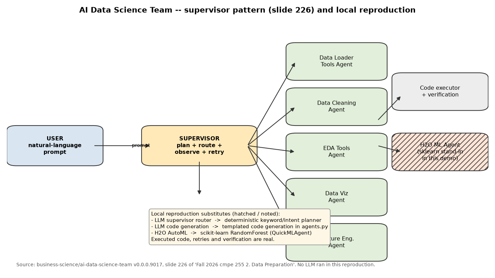
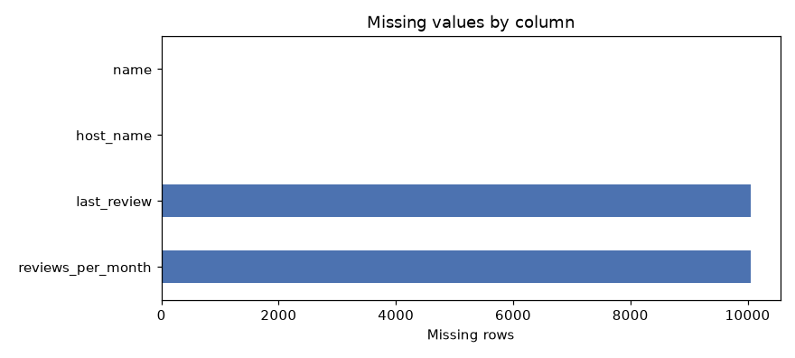
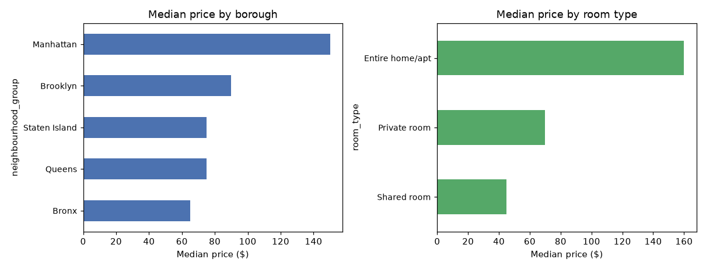
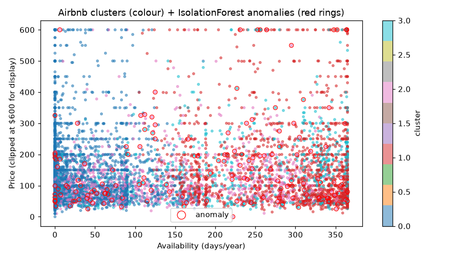
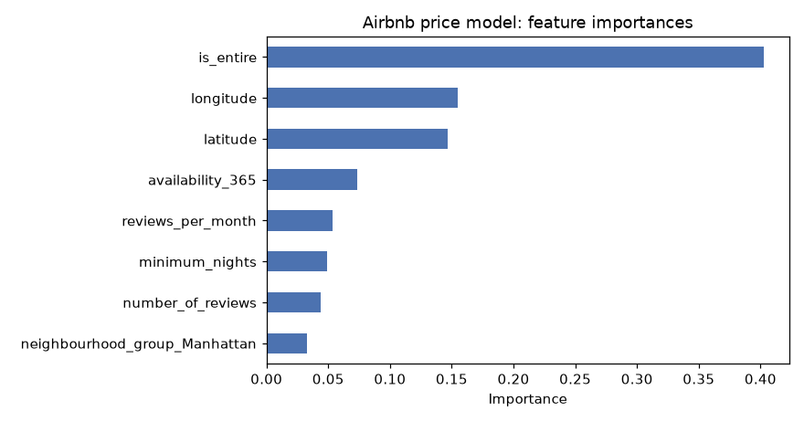
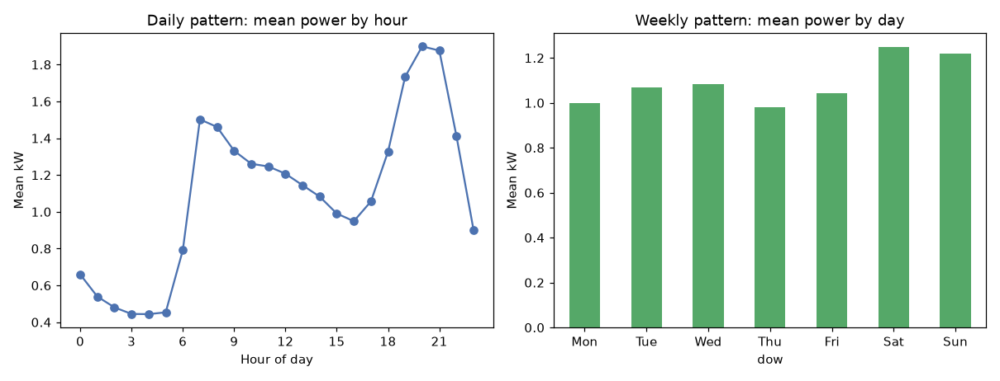
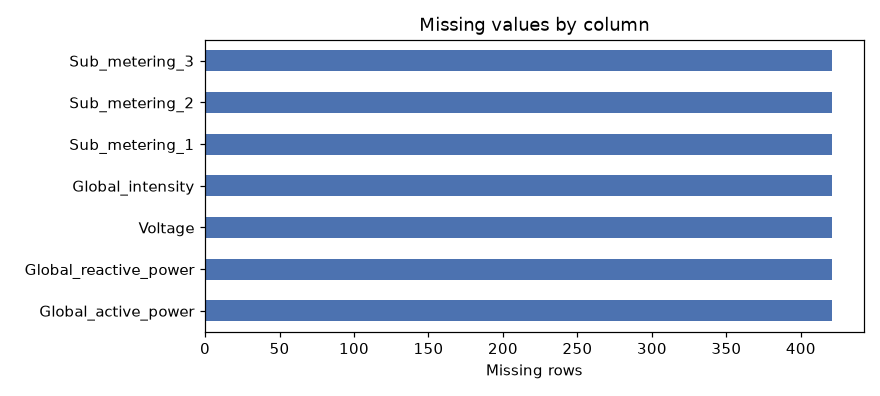
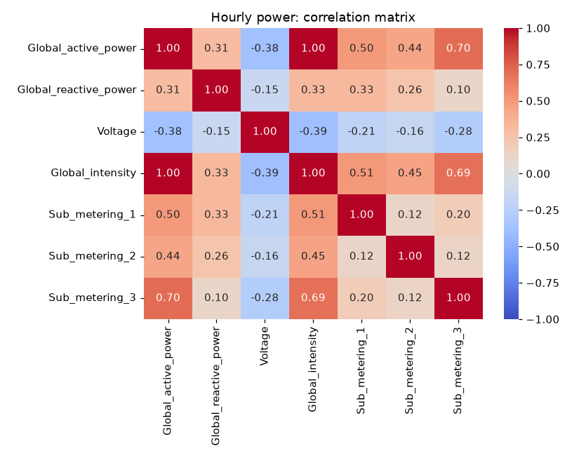
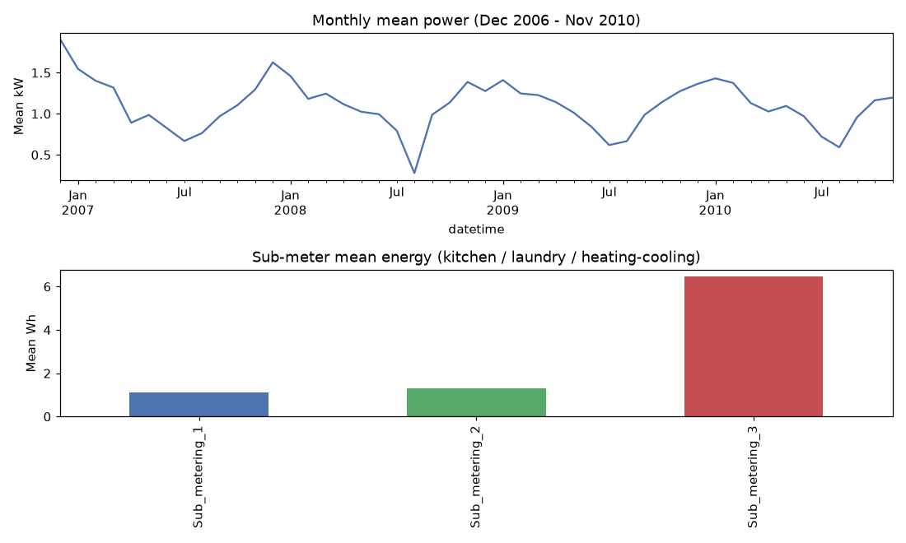
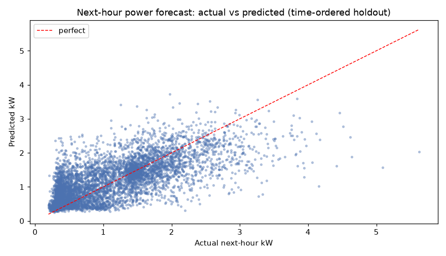

# User Journey — Agentic EDA with the AI Data Science Team

**Tool:** AI Data Science Team — https://github.com/business-science/ai-data-science-team — slide 226 of *"Fall 2026 cmpe 255 2. Data Preparation"* (deck: https://docs.google.com/presentation/d/12V4wXjPd0ymc4tcFSsQdpeQFYdtKwzQglG81nXYEO0k/ ; section slides 222–228, summary slide 225).
**Author:** Pranith Varma Pakalapati, CMPE 255, SJSU, Fall 2026.

Two journeys are described. **§A actually ran** (the notebook journey, executed 2026-11-17). **§B is documented-not-run** (the Pipeline Studio UI journey, from the repo docs — it needs the full install plus an LLM key, neither available here). Nothing in §B is claimed to have been executed.

## §A. The notebook journey (actually run)

Each step states what the user types/clicks, what they see, and which figure is produced. "Screenshots-equivalent" = the executed notebook cells + saved figures; open `Agentic_EDA_AI_Data_Science_Team.ipynb` to see every step with its outputs.

### Step 0 — Install (terminal)

The user types:

```bash
cd part2-agentic-eda
python -m venv venv && source venv/bin/activate
pip install -r requirements.txt
```

They see pip install the pinned data-science stack. No API key is asked for at any point. (The real library's install story, including its failed full install on a 206 MB GPU wheel, is recorded in `investigation.md`.)

### Step 1 — Open the notebook

The user opens `Agentic_EDA_AI_Data_Science_Team.ipynb` in Jupyter/VS Code/Colab. They see the title, the honesty label (no LLM ran; deterministic planner), the dataset descriptions, and the contents list.

### Step 2 — Run setup

The user runs the setup cell. They see:

```
airbnb: 48,895 rows x 16 columns
power: 34,589 rows x 9 columns
Supervisor ready. Specialists: DataLoaderToolsAgent, DataCleaningAgent, ...
```

The next cell draws and displays the architecture diagram.


*Figure A1 — `figures/architecture.png`: the supervisor pattern and the local reproduction's substitutions.*

### Step 3 — P1: "Profile this dataset and flag data-quality issues."

The user runs the P1 cell. They see the Supervisor plan (Loader → EDA Tools → Cleaning), each tool call with a generated-code excerpt, the executed `describe()` table, the quality flags (price skew, 10,052 missing review fields, 11 $0 prices), the insight, and `Verification PASS`.


*Figure A2 — `figures/missingness_airbnb.png`: missing values by column (Airbnb).*

### Step 4 — P2: "Which boroughs and room types drive price?"

The user runs the P2 cell. They see group-median tables, the borough × room-type matrix, weak numeric correlations, and the chart below. Takeaway they read: Manhattan + Entire home/apt dominate; review counts do not.


*Figure A3 — `figures/airbnb_price_by_borough_room.png`: median price by borough and room type.*

### Step 5 — P3: "Show missingness and suggest imputation."

The user runs the P3 cell. They see the missingness chart again plus the Supervisor's justification: 0-fill for `reviews_per_month` (missing ⟺ never reviewed), `last_review` left missing, identifiers dropped. Verification confirms every missing row has zero reviews.

### Step 6 — P4: "Clean the data … and prepare modelling features."

The user runs the P4 cell. They see the cleaning log (48,895 → 48,645 rows; 9,919 imputations) and the first rows of the modelling frame with `log_price` and `is_entire`. No figure — the artefact is the cleaned frame carried in Supervisor context.

### Step 7 — P5: "Find clusters and anomalies in the listings."

The user runs the P5 cell. They see the 4-cluster profile table, the 160-anomaly count, and the scatter below (clusters in colour, anomalies ringed red).


*Figure A4 — `figures/airbnb_clusters.png`: KMeans clusters + IsolationForest anomalies.*

### Step 8 — P6: "Build a quick price model and explain it."

The user runs the P6 cell. They see R² = 0.638, RMSE(log) = 0.402, MAE = $45.72, and the importances chart. The Supervisor's explanation names `is_entire`, longitude, and latitude as the drivers.


*Figure A5 — `figures/airbnb_model_importances.png`: price-model feature importances.*

### Step 9 — P7: "What is the daily and weekly pattern in power use?"

The user runs the P7 cell. They see something different: **the first attempt fails**. The output shows `TypeError: Only valid with DatetimeIndex ... but got an instance of 'RangeIndex'`, then `Supervisor: retrying once with repaired code ...`, then the successful run — peak 20:00, trough 04:00, weekend > weekday — and the chart below. This is the error-recovery trace; both attempts are preserved verbatim in `agent_transcript.md`.


*Figure A6 — `figures/power_daily_weekly.png`: mean power by hour of day and day of week.*

### Step 10 — P8: "Profile the hourly power data, flag gaps and anomalies."

The user runs the P8 cell. They see the range (Dec 2006–Nov 2010), 421 missing hours, 733 IQR outliers, and the missingness chart.


*Figure A7 — `figures/missingness_power.png`: missing values by column (hourly power).*

### Step 11 — P9: "Show the trend and seasonality, and which sub-meters drive total power."

The user runs the P9 cell. They see the correlation table (Global_intensity 0.999 flagged as near-duplicate; Sub_metering_3 0.696 strongest real driver), the monthly trend, and sub-meter means.


*Figure A8 — `figures/power_correlation.png`: hourly power correlation matrix.*


*Figure A9 — `figures/power_trend_submeters.png`: monthly mean power + sub-meter means.*

### Step 12 — P10: "Build a quick next-hour power forecast and explain it."

The user runs the P10 cell. They see gap interpolation, lag/cyclical features, the time-ordered holdout result (MAE 0.360 kW vs naive 0.396 kW), and the actual-vs-predicted scatter.


*Figure A10 — `figures/power_forecast_actual_vs_pred.png`: next-hour forecast, actual vs predicted.*

### Step 13 — Export the evidence

The user runs the final cell. They see `metrics.json` printed (10 prompts, 20 tool calls, 1 retry, 10/10 verifications) and `agent_transcript.md` regenerated with every prompt, plan, tool call, full generated code, executed output, insight, and verification note.

## §B. The AI Pipeline Studio journey (DOCUMENTED-NOT-RUN)

The following is reconstructed from the repository README and app docs (`apps/ai-pipeline-studio-app/README.md`) for the same tool and datasets. **It was not executed**: it requires the full library install (including Streamlit) and an LLM API key or local Ollama server, neither available in this environment (see `investigation.md` §§4–5). Steps are what the user *would* do; no screenshots exist because no session ran.

1. **Install + key.** Clone https://github.com/business-science/ai-data-science-team, `pip install -e .`, set `OPENAI_API_KEY` in the environment (or start Ollama with `llama3.1:8b`).
2. **Launch.** `streamlit run apps/ai-pipeline-studio-app/app.py`; the Studio opens in the browser with the pipeline canvas and Table/Chart/EDA/Code/Model/Predictions/MLflow tabs.
3. **Load data.** Upload `AB_NYC_2019.csv` (or point the Data Loader agent at the file) and `household_power_hourly.csv`; the Loader agent previews schema and row counts in the Table view.
4. **Chat a request.** In the chat/prompt box, type e.g. *"Profile this dataset and flag data-quality issues."* The Supervisor routes to the EDA Tools and Cleaning agents; the user watches steps appear as pipeline nodes with lineage.
5. **Review artefacts.** Switch to the Chart tab for the missingness/price charts, the EDA tab for the describe/correlation outputs, and the Code tab for the generated, reproducible pipeline script.
6. **Iterate in plain language.** *"Which boroughs and room types drive price?"* → new nodes; *"Clean the data and build a quick price model"* → Cleaning → Feature Engineering → H2O ML nodes, with Model/Predictions tabs showing metrics.
7. **Save + export.** Save the project (metadata-only or full-data) and export the generated Python pipeline for reuse; MLflow tab records runs if MLflow tracking is enabled.

**Equivalence note:** §A's prompts P1–P10 are the same requests a user would type in §B steps 4–6, and §A's plan/tool/result log is the same evidence the Studio's pipeline canvas + Code tab would show. The difference is the interface (notebook cells vs Streamlit canvas) and the planner (deterministic vs LLM). `run_real_library.py` is the bridge: with a key, it runs the real agents on these same prompts.
